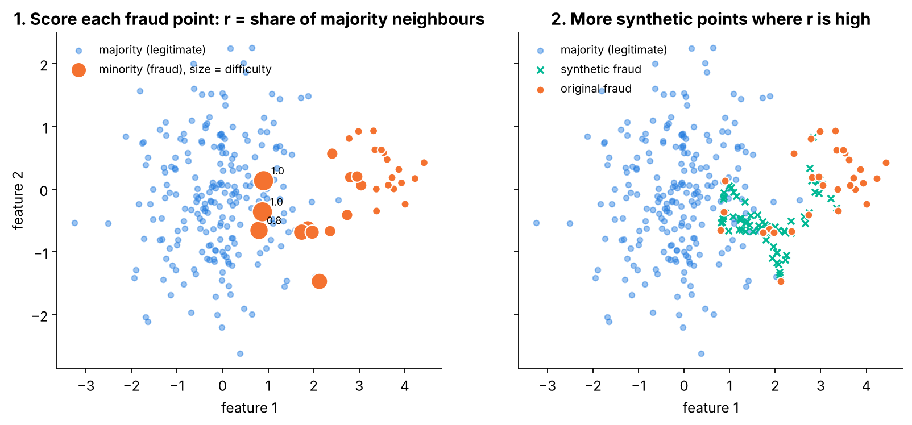
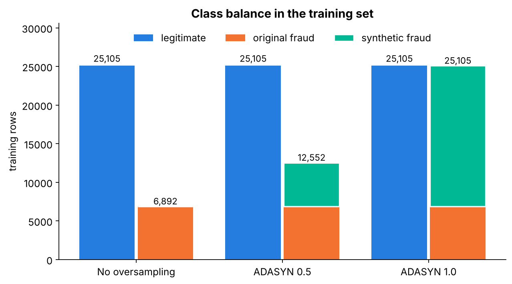
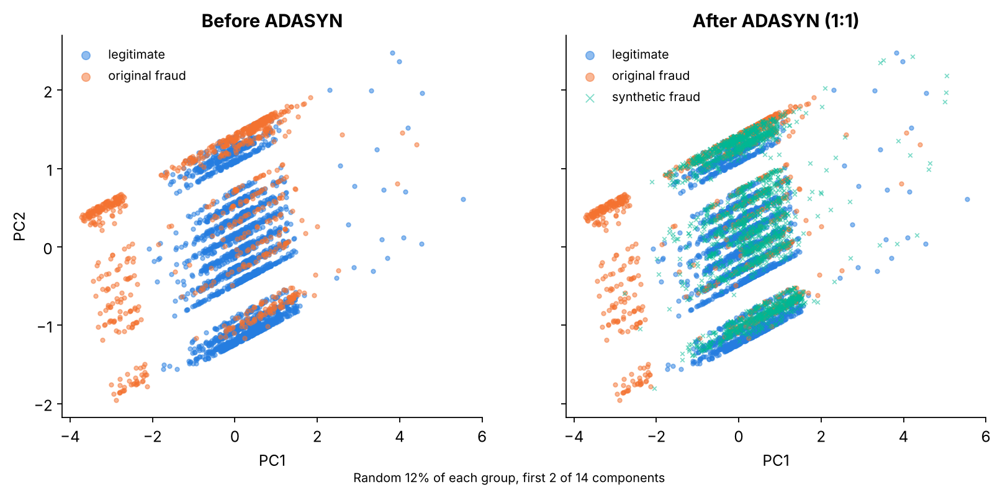
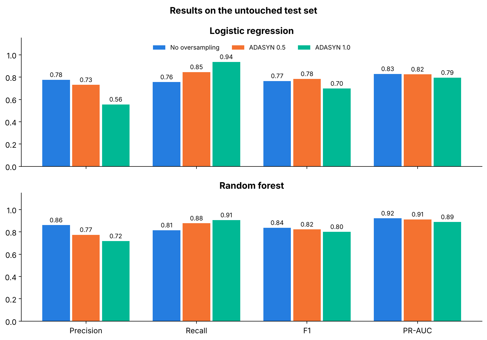

# ADASYN: Adaptive Synthetic Sampling

## 1. The problem

Our PCA training set is imbalanced: **6,892 fraud** against **25,105 legitimate** rows (21.5% fraud).
A model trained on it sees legitimate transactions far more often and can miss fraud.

## 2. The idea

ADASYN (He et al., 2008) creates synthetic minority rows, **more of them where fraud is harder to learn**.



*Illustration on made-up 2D data.*

| Step | Formula |
|---|---|
| 1. Rows to create | `G = ratio × majority − minority` |
| 2. Difficulty of fraud row *i* (k = 5) | `r_i = majority neighbours / k` |
| 3. Share for row *i* | `g_i = r_i / Σr × G` |
| 4. New row | `x_new = x_i + λ (x_neighbour − x_i)`, `λ ∈ [0, 1)` |

`x_neighbour` is one of the 5 nearest **fraud** neighbours.

**Compared with SMOTE:** SMOTE spreads new rows roughly evenly over the minority rows; ADASYN weights them by difficulty.

## 3. Where it fits in our pipeline

```
... -> 10A feature subset -> 11 PCA + train/test split
                                |-- 11A train -> 12 ADASYN -> 12A train (balanced)
                                |-- 11B test  -> unchanged, used only for evaluation
```

We use `11A` because its 14 components are numeric and continuous, and the test set is already separate.

## 4. Result



With ratio 1.0, **18,213** synthetic rows are added (31,997 → 50,210 rows).
**4,156 of the 6,892** fraud rows have no legitimate neighbour (r = 0), so nothing is generated from them as a starting point.



The new points concentrate where fraud and legitimate transactions overlap.

## 5. Does it help?

Same models, same untouched test set (8,000 rows, 1,723 fraud), default decision threshold.



| Model | Training data | Frauds caught | Frauds missed | False alarms |
|---|---|---:|---:|---:|
| Logistic regression | No oversampling | 1,301 | 422 | 376 |
| Logistic regression | ADASYN 0.5 | 1,457 | 266 | 538 |
| Logistic regression | ADASYN 1.0 | 1,613 | 110 | 1,292 |
| Random forest | No oversampling | 1,404 | 319 | 228 |
| Random forest | ADASYN 0.5 | 1,512 | 211 | 441 |
| Random forest | ADASYN 1.0 | 1,560 | 163 | 615 |

## 6. Conclusions

- **Recall rises** in both models: fewer frauds are missed.
- **Precision falls:** there are more false alarms.
- **PR-AUC does not improve** in either model, so ADASYN mainly shifts the trade-off at the default threshold. Tuning that threshold is an alternative worth comparing.
- **F1** improves only for logistic regression with ratio 0.5 (0.77 → 0.78).
- Choose by cost: if a missed fraud is much more expensive than a false alarm, ADASYN is useful.

## 7. Limitations

- Single train/test split and no hyperparameter tuning.
- Scaling and feature selection were fitted before the split, so scores may be slightly optimistic.
- Many original features are 0/1; interpolation in PCA space can produce in-between categories.
- ADASYN can amplify noise and outliers. Phase II outlier treatment is not applied here.

## 8. How to run

```
python src/phase_1/12_1_adasyn_oversampling.py              # ratio 1.0
python src/phase_1/12_1_adasyn_oversampling.py --ratio 0.5
python src/phase_1/12_2_adasyn_visualization.py             # figures + evaluation
python -m unittest discover -s tests -p "test_adasyn_oversampling.py" -v
```

ADASYN is implemented with NumPy and scikit-learn, so `imbalanced-learn` is not required.
Results can differ slightly from that library because of rounding and random sampling.

**Reference:** H. He, Y. Bai, E. A. Garcia, S. Li, *ADASYN: Adaptive synthetic sampling approach for imbalanced learning*, IJCNN 2008.
