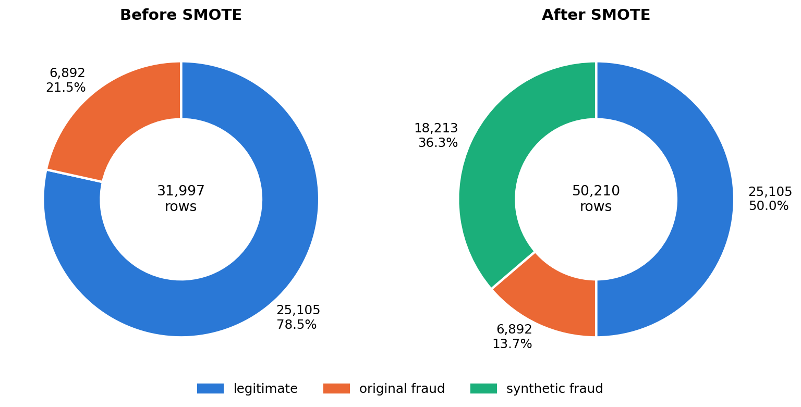
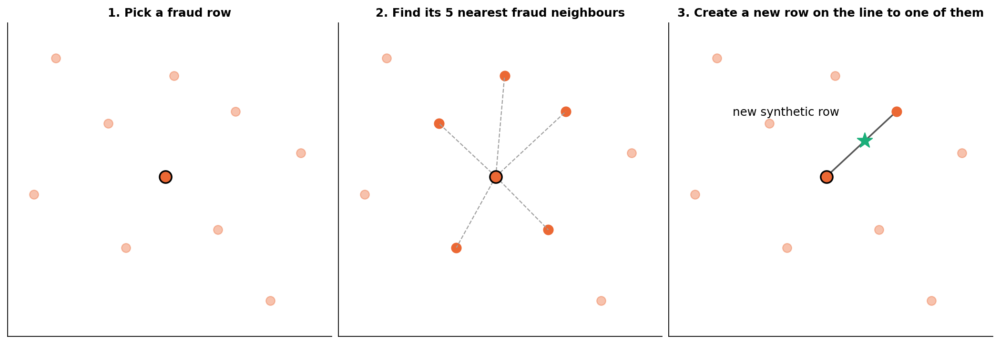
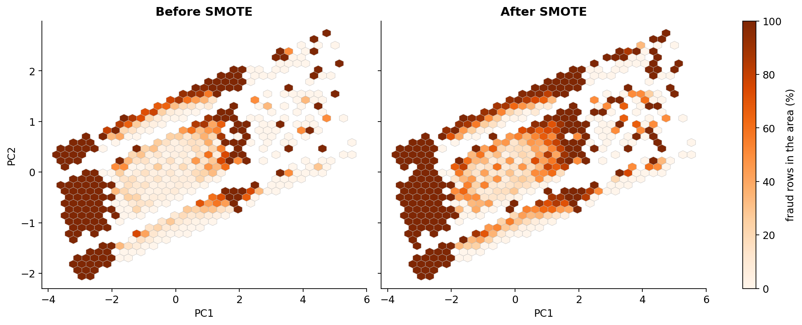
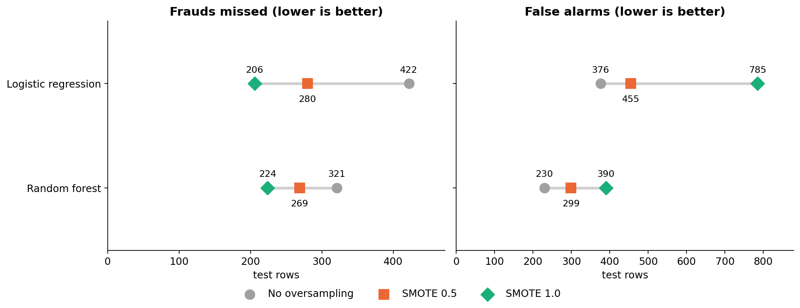

# SMOTE: before and after

## 1. Before: the data was imbalanced

Only 6,892 of the 31,997 training rows (21.5%) were fraud. A model sees legitimate transactions much more often and can miss fraud.

## 2. What we did

We used SMOTE to create 18,213 synthetic fraud rows. Each one lies between a real fraud row and one of its 5 nearest fraud neighbours. After this, both classes have 25,105 rows. *(The figure uses made-up points.)*

SMOTE was applied only to the training data. The 8,000 test rows were not changed.

## 3. How the training data changed

Each cell is an area of the first two PCA components. A darker cell has a larger share of fraud. After SMOTE, fraud has more weight in the areas where it already appeared.

## 4. What changed in the results

We trained logistic regression and random forest without oversampling, with SMOTE 0.5 (one fraud row per two legitimate rows) and with SMOTE 1.0 (equal classes).

- **Fewer frauds are missed** when more synthetic rows are added.
- **More false alarms** are raised at the same time.

## Conclusion

SMOTE helps the models catch more frauds, but flags more legitimate transactions. It is useful when missing a fraud costs more than a false alarm.

These results come from a single train/test split without hyperparameter tuning. Scaling and feature selection were fitted before the split, so scores may be slightly optimistic.